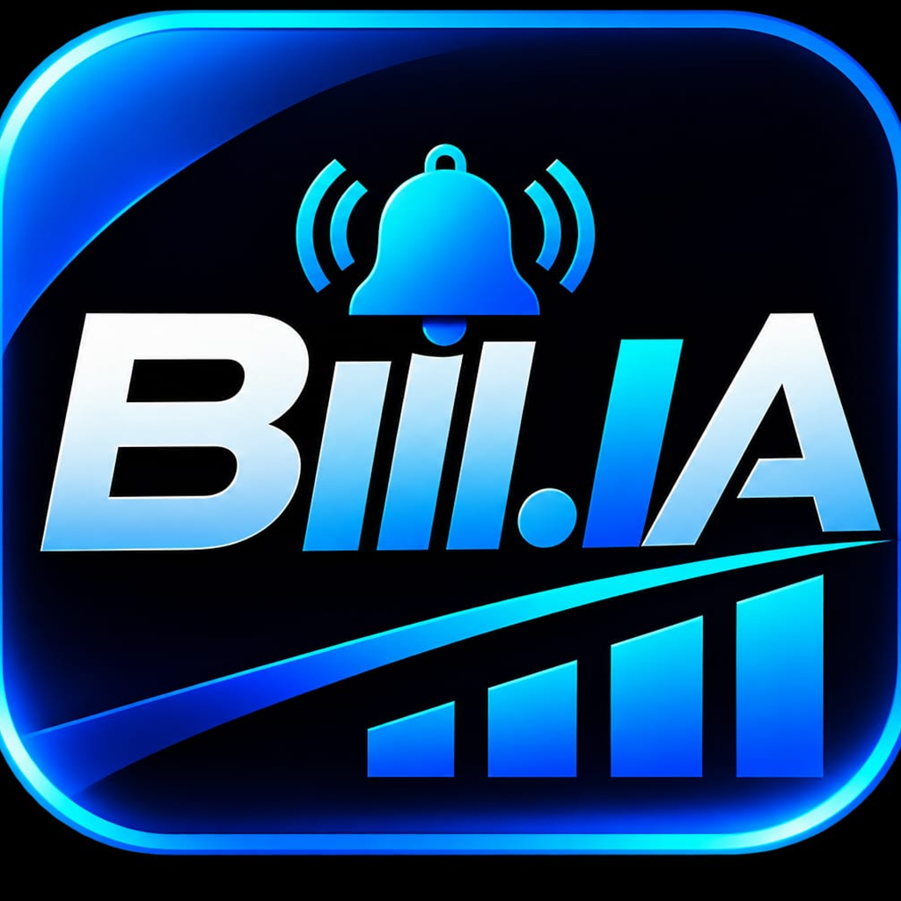

<p align="center">
  
</p>

<h1 align="center">Bill.ia</h1>

<p align="center">
  Assistente de lembretes por conversa para Android.<br />
  Você escreve como fala, e o Bill anota, agenda e te avisa na hora certa.
</p>

---

## O que ele faz

- **Entende frases em português.** Escreva "me lembra de tomar remédio daqui 10 minutos" e o lembrete é criado, sem formulário.
- **Modo chamada.** Diga "me liga..." (ou ligue o botão *Tocar como chamada*) e o aviso toca com vibração longa e insiste de novo depois de 30 e 60 segundos, até você tocar na notificação.
- **Horário exato.** Os lembretes são agendados como despertador, então o Android não os atrasa.
- **Lembretes, tarefas e agenda.** Tarefas sem horário, lembretes com horário e compromissos, com uma aba de agenda dos próximos 7 dias.
- **Calendário do celular.** Opcionalmente salva os lembretes no calendário do aparelho e mostra seus eventos na agenda.
- **Sem conta e sem servidor.** Tudo fica salvo só no celular, em um banco SQLite local. Nada é enviado para a internet.

## Exemplos de frases

| Você escreve | O Bill entende |
|---|---|
| me lembra de tomar remédio daqui 10 minutos | lembrete daqui a 10 minutos |
| me liga daqui a 2 horas para buscar as crianças | lembrete em modo chamada daqui a 2 horas |
| reunião com o João sexta às 15h30 | compromisso na próxima sexta às 15:30 |
| me lembre de ligar pro médico em meia hora | lembrete daqui a 30 minutos |
| dentista dia 25 às 14h | dia 25 às 14:00 |
| aniversário da Ana 05/12 | 5 de dezembro às 9:00 |
| academia hoje à noite | hoje às 20:00 |
| almoço com a equipe amanhã ao meio-dia | amanhã às 12:00 |
| tarefa comprar pão | tarefa sem horário |
| o que tenho hoje? | lista o que está marcado para hoje |

O interpretador é local ([`src/parser.ts`](src/parser.ts)) e reconhece tempo relativo, dias da semana, datas, horários e períodos do dia ("de manhã", "à tarde", "à noite").

## Tecnologias

- [Expo](https://expo.dev) SDK 58 e React Native 0.88, em TypeScript
- `expo-notifications` para os lembretes, `expo-calendar` para o calendário e `expo-sqlite` para o armazenamento local
- [EAS Build](https://docs.expo.dev/build/introduction/) para gerar o APK

## Como rodar

Pré-requisitos: [Node.js](https://nodejs.org) e o app **Expo Go** no celular Android.

```bash
git clone https://github.com/AlberthyFerraz/bill-ia.git
cd bill-ia
npm install
npx expo start
```

Escaneie o QR code com o Expo Go. Se o celular não conseguir acessar o PC pelo Wi-Fi, conecte pelo cabo USB e use:

```bash
adb reverse tcp:8081 tcp:8081
```

e abra `exp://127.0.0.1:8081` no Expo Go.

> No Expo Go, o modo chamada usa o canal de notificação padrão do Expo Go. A experiência completa (canal próprio de chamada) está no APK.

## Como gerar o APK

```bash
npx eas-cli@latest login
npx eas-cli@latest build -p android --profile preview
```

O perfil `preview` (em [`eas.json`](eas.json)) gera um `.apk` que pode ser instalado direto no celular. O APK é gerado só para processadores `arm64-v8a`, que cobrem praticamente todos os celulares Android atuais, o que deixa o arquivo com cerca de 23 MB.

Antes de cada novo build, aumente `version` e `android.versionCode` no [`app.json`](app.json) para o APK instalar como atualização.

## Estrutura do projeto

```
App.tsx                     abas, abertura e permissões
src/
  parser.ts                 interpretador de frases em português
  actions.ts                transforma a mensagem em lembrete e monta a resposta
  notifications.ts          agendamento, modo chamada e permissões
  calendar.ts               calendário do celular
  db.ts                     banco SQLite local
  theme.ts                  paleta de cores
  components/
    LoadingScreen.tsx       abertura com a logo e o sino animado
    BottomBar.tsx           barra de abas
  screens/
    ChatScreen.tsx          conversa
    RemindersScreen.tsx     lembretes e tarefas
    AgendaScreen.tsx        próximos 7 dias
    ProfileScreen.tsx       nome e configurações
```

## Verificações

```bash
npx tsc --noEmit      # tipos
npx eslint App.tsx src
npx expo-doctor       # dependências e configuração
```

## Licença

Distribuído sob a licença MIT. Veja [`LICENSE`](LICENSE).
